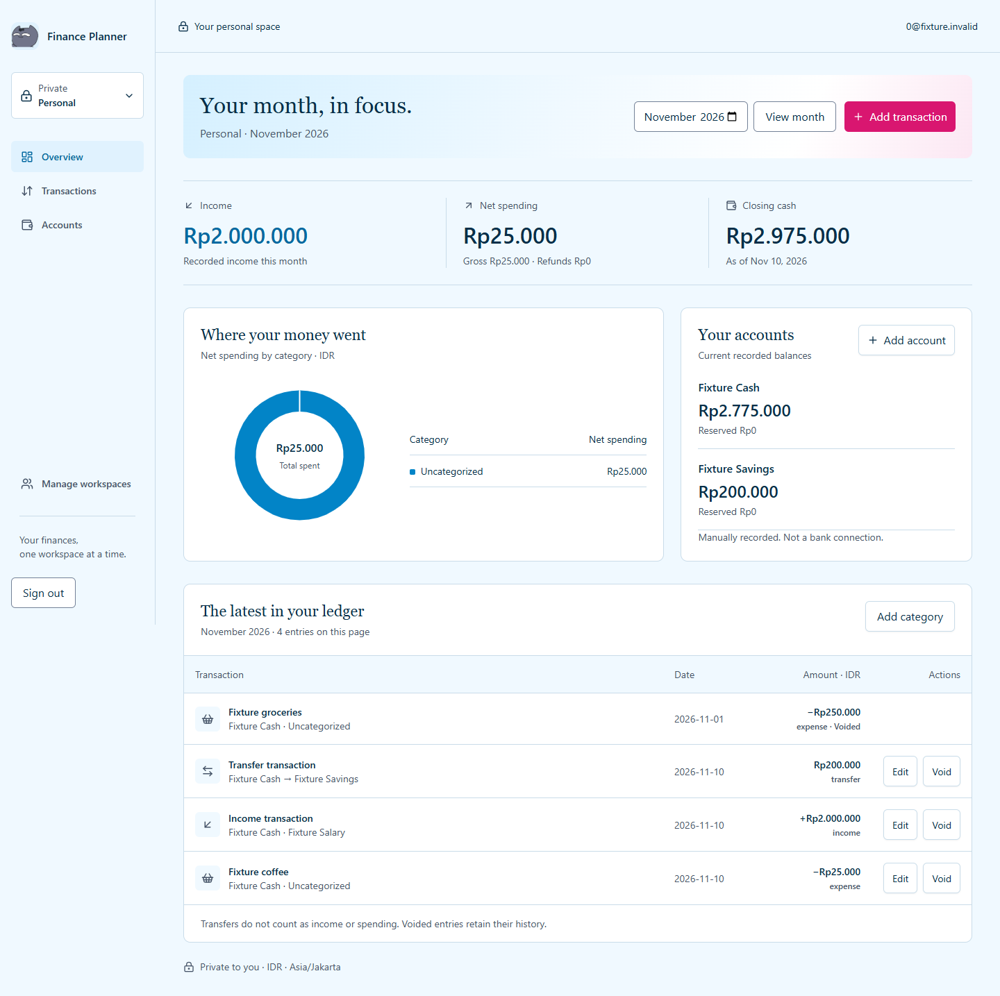
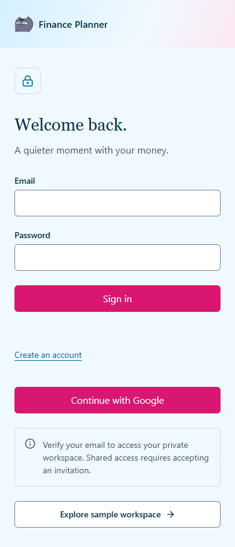
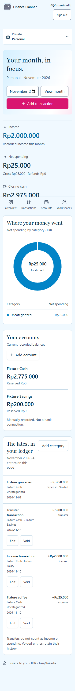
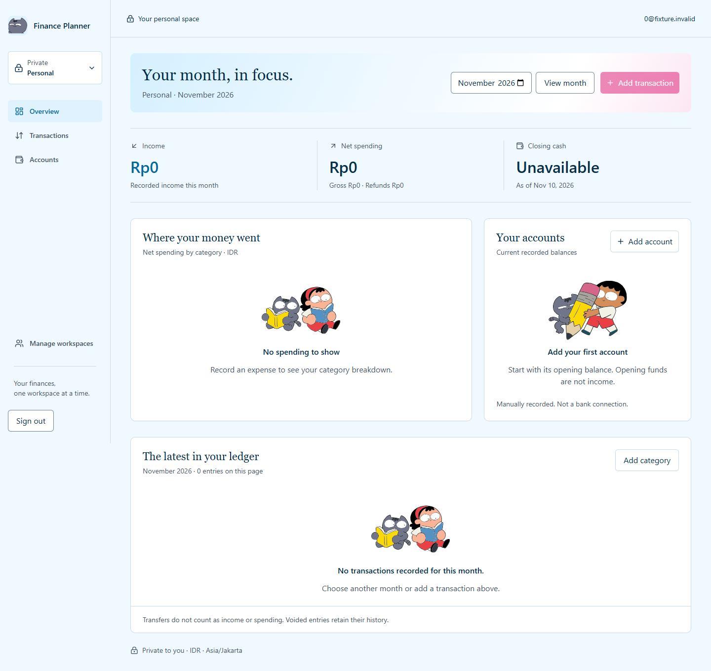

<div align="center">
  
  <h1>Finance Planner</h1>
  <p><strong>A little clarity, one month at a time.</strong></p>
  <p>Catat keuangan pribadi dan bersama, dengan ruang yang tetap terpisah.</p>
  <p>
    
    
    
    
  </p>
  <p><a href="#preview">Preview</a> · <a href="#fitur">Fitur &amp; Status</a> · <a href="#setup">Mulai Lokal</a> · <a href="#checks">Development Checks</a> · <a href="#dokumentasi">Dokumentasi</a></p>
</div>

---

**Finance Planner** membantu mencatat akun, pemasukan, pengeluaran, dan transfer dalam workspace pribadi atau bersama. Ringkasan bulanan memakai nilai **IDR rupiah utuh**, tanggal finansial **Asia/Jakarta**, serta tabel kategori dengan nominal persis di samping grafik.

> **Status:** alur transaksi dan branding telah diimplementasikan serta diuji secara lokal. Budgets, goals, dan settings masih berupa **sample prototype**. Verifikasi Supabase hosted dan persetujuan rilis belum selesai; jangan gunakan data keuangan nyata dahulu.

<a id="preview"></a>

## ✨ Preview

Screenshot berikut memakai identitas dan transaksi sintetis dari pengujian lokal.

<p align="center">
  <a href="artifacts/branding/after-desktop.png"></a>
</p>

<details>
<summary><strong>Lihat sign-in, ilustrasi empty state, dan tampilan mobile</strong></summary>

<p align="center">
  <a href="artifacts/branding/sign-in-390.png"></a>
  <a href="artifacts/branding/after-mobile.png"></a>
</p>

<p align="center">
  <a href="artifacts/branding/empty-desktop.png"></a>
</p>

</details>

<a id="fitur"></a>

## 🧾 Fitur & Status

| Bagian | Implementasi saat ini | Batas |
| --- | --- | --- |
| Autentikasi | Email/password, konfirmasi email, Google OAuth bila dikonfigurasi | Delivery email dan consent Google hosted belum diverifikasi |
| Workspace pribadi | Provisioning untuk identitas terverifikasi; akses data terisolasi | Berpindah workspace tidak mengubah identitas |
| Workspace bersama | Pembuatan workspace, undangan berbasis UUID, penerimaan eksplisit | Undangan hanya di aplikasi; tidak mengirim email |
| Akun & kategori | Saldo awal akun; kategori pemasukan/pengeluaran | Belum ada koneksi bank atau lifecycle kategori lengkap |
| Transaksi | Buat/edit pemasukan, pengeluaran, transfer; void dengan alasan | Jenis transaksi tidak berubah saat edit; belum ada UI refund/correction |
| Ringkasan bulanan | Income, net spending, closing cash, donut kategori dan tabel nominal persis | Perhitungan scoped per workspace; tanpa total gabungan pribadi/shared |
| Penyimpanan & konflik | Konfirmasi setelah tersimpan, retry idempoten, pemeriksaan versi | Konflik membutuhkan reload; draft hanya di memori |
| Identitas visual | Logo kucing, ikon aplikasi, ilustrasi empty state, desktop/mobile navigation | Ilustrasi melengkapi konteks, bukan menyatakan saldo atau sukses |
| Budgets, goals, settings | Preview berlabel sample dengan state loading/empty/error | Belum menjadi fitur tulis keuangan live |

**Alur utama:** masuk → pilih workspace → tambah akun dan saldo awal → catat transaksi → periksa bulan dan kategori.

Route live: `/workspaces` dan `/w/[workspaceId]`. `/`, `/accounts`, serta `/transactions` mengarah ke discovery workspace. Preview terpisah tersedia di `/budgets`, `/goals`, dan `/settings`.

<a id="setup"></a>

## 🚀 Mulai Lokal

**Prasyarat:** Node.js **24 LTS**, npm, dan proyek Supabase yang disiapkan sesuai [panduan database](docs/DATABASE.md) serta [panduan Auth/workspace](docs/AUTH_WORKSPACES.md).

### 1. Ambil source dan dependency

```sh
git clone https://github.com/RicardoCuthbert/Tracker.git
cd Tracker
npm ci
```

### 2. Siapkan environment

Salin `.env.example` menjadi `.env.local`:

```powershell
# PowerShell (Windows)
Copy-Item .env.example .env.local
```

```sh
# macOS / Linux
cp .env.example .env.local
```

| Variable | Kebutuhan | Isi |
| --- | --- | --- |
| `NEXT_PUBLIC_SUPABASE_URL` | Aplikasi live | URL proyek Supabase |
| `NEXT_PUBLIC_SUPABASE_PUBLISHABLE_KEY` | Aplikasi live | Publishable key; jangan isi secret/service-role key |
| `SITE_URL` | Aplikasi live | Origin kanonis, misalnya `http://127.0.0.1:3000` |
| `TEST_DATABASE_URL` | Opsional, tes concurrency | PostgreSQL lokal khusus fixture; jangan gunakan database produksi |

`.env.local` diabaikan Git. Credential tidak masuk README, screenshot, atau source control.

### 3. Siapkan database dan Auth

Tinjau migration **001–004** secara berurutan; operator berwenang hanya menerapkan yang belum ada. Migration 004 memperluas provisioning ke **semua identitas terverifikasi**, termasuk pengguna yang sebelumnya tidak masuk allowlist. Ikuti konfigurasi email confirmation, callback, dan Google pada [AUTH_WORKSPACES.md](docs/AUTH_WORKSPACES.md).

Perubahan migration remote, konfigurasi hosted, dan deployment memerlukan persetujuan owner terpisah. Push source ke GitHub bukan bukti bahwa database hosted sudah siap.

### 4. Jalankan aplikasi

```sh
npm run dev
```

Buka **[http://127.0.0.1:3000](http://127.0.0.1:3000)**. Untuk preview production lokal:

```sh
npm run build
npm start
```

Webpack dipilih eksplisit karena subprocess PostCSS Turbopack gagal pada lingkungan Windows pengembangan. Tidak ada patch ke internal framework.

<a id="arsitektur"></a>

## 🏗️ Arsitektur & Aturan Keuangan

```text
Browser · workspace dan bulan aktif
   ↓
Next.js · verified session, validasi, Server Actions
   ↓ user-scoped client
Supabase · public RPC → ledger PostgreSQL + RLS + audit
```

| Lapisan | Stack / tanggung jawab |
| --- | --- |
| UI | Next.js App Router, React, Tailwind CSS, shadcn/ui |
| Grafik | Recharts dengan tabel nominal persis dan guard konversi angka |
| Domain & kontrak | TypeScript strict, bigint, integer string pada RPC JSON |
| Identitas & akses | Supabase Auth, workspace membership, PostgreSQL RLS |
| Integritas tulis | RPC atomik, operation UUID, optimistic revision, audit scoped |

- **Saldo awal bukan income.** Transfer atomik tidak dihitung sebagai pemasukan atau pengeluaran.
- **Privasi per workspace.** Keanggotaan shared tidak membuka akun pribadi; tidak ada mirroring otomatis atau split/reimbursement.
- **Uang tanpa float.** PostgreSQL/TypeScript memakai bigint; JSON membawa integer string tanpa pembulatan diam-diam.
- **Riwayat dipertahankan.** Void menyimpan jejak dan alasan; UI biasa tidak menghapus histori finansial.
- **Draft mengikuti identitas.** Tampilan privat disembunyikan saat blur, akses diperiksa kembali, dan pergantian identitas membuang draft lama.

### Struktur repository

```text
Tracker/
├── src/app/                  # Routes, layouts, Auth, metadata dan ikon
├── src/features/
│   ├── transactions/         # Form, validasi, command dan write boundary
│   ├── workspaces/           # Discovery, sharing, live shell dan privasi
│   └── prototype/            # Preview sample terpisah
├── src/components/           # shadcn/ui dan komponen brand
├── src/lib/                  # Money/date helpers dan Supabase clients/contracts
├── supabase/migrations/      # Schema, operasi ledger dan workspace RPC
├── public/illustrations/     # Aset optimasi dan inventory sumber
├── Asset lucu lucu/           # Aset ilustrasi asli, dipertahankan utuh
├── artifacts/branding/       # Screenshot dan bukti visual sintetis
├── tests/                    # Unit, database/RLS dan browser
├── scripts/                  # Audit, type generation, smoke dan optimasi aset
└── docs/                     # Product, aturan domain, keputusan dan evidence
```

<a id="checks"></a>

## 🧪 Development Checks

```sh
npm run lint
npm run typecheck
npm test
npm run test:db
npm run build
npm run audit:local
```

<details>
<summary><strong>Browser, HTTP, database native, dan audit tambahan</strong></summary>

| Command | Persiapan dan cakupan |
| --- | --- |
| `npm run test:e2e` | Setelah build; Auth/HTTP lokal, ledger SQL/RLS, dua identitas sintetis, CRUD, retry/conflict, privacy dan reflow. Port 3142/3143 |
| `node tests/e2e/branding.mjs` | Setelah build; logo/ikon, aset, empty states, navigasi dan lima lebar layar. Port 3144 |
| `npm run test:integration` | Jalankan preview production pada port 3131 dahulu; guards, redirects, cache headers dan penolakan action tanpa autentikasi |
| `npm run db:types` | Regenerasi kontrak RPC; `typecheck` memeriksa kesesuaiannya |
| `npm run audit:staging` | Audit discovery hosted read-only; gagal bila signature RPC yang diperlukan belum tersedia |

Browser suite memerlukan Playwright/browser yang sudah terpasang. Jika tidak ter-resolve, set `PLAYWRIGHT_MODULE` ke path absolut `index.mjs`; `CHROME_PATH` opsional menunjuk executable Chrome. Tidak ada dependency Playwright di package aplikasi. Hasil run tersimpan di `test-results/` yang diabaikan Git.

Tes database default memakai PGlite dengan role PostgreSQL/RLS sesungguhnya. Pemeriksaan multi-connection membutuhkan `TEST_DATABASE_URL` ke cluster loopback khusus fixture; tanpa itu satu tes concurrency dilewati. Persyaratan lengkap: [DATABASE.md](docs/DATABASE.md).

Preview HTTP pada port 3131:

```sh
npm run start -- --port 3131
```

Jalankan `npm run test:integration` dari terminal kedua.

</details>

<details>
<summary><strong>🛠 Troubleshooting</strong></summary>

| Gejala | Periksa |
| --- | --- |
| Konfigurasi live tidak tersedia | Tiga variable aplikasi, origin `SITE_URL`, dan format publishable key |
| Sign-in atau confirmation gagal | Provider Auth, email delivery, callback allowlist dan kecocokan proyek |
| RPC tidak ditemukan | Migration yang sudah diterapkan dan kontrak pada panduan database; jangan mengganti kegagalan dengan data sample |
| Workspace tidak bisa diakses | Identitas terverifikasi dan membership aktif; undangan pending belum memberi akses |
| Konflik saat edit | Reload data terbaru sebelum mengirim command baru |
| Hasil save belum pasti | Gunakan retry command yang sama dari UI agar transaksi tidak digandakan |
| Playwright tidak ditemukan | Instalasi browser tooling terpisah atau `PLAYWRIGHT_MODULE` dan `CHROME_PATH` |
| Concurrency test skipped | Siapkan database lokal terisolasi sesuai kontrak `TEST_DATABASE_URL` |

</details>

<a id="dokumentasi"></a>

## 📚 Dokumentasi & Kontribusi

| Tujuan | Referensi |
| --- | --- |
| Memahami produk dan batas scope | [Product](docs/PRODUCT.md) · [Roadmap](docs/ROADMAP.md) |
| Membaca aturan uang, tanggal dan privasi | [Domain rules](docs/DOMAIN_RULES.md) · [Decisions](docs/DECISIONS.md) |
| Menyiapkan database dan identitas | [Database](docs/DATABASE.md) · [Auth & workspaces](docs/AUTH_WORKSPACES.md) |
| Memahami transaksi dan UX live | [Transaction management](docs/TRANSACTION_MANAGEMENT.md) · [UX review](docs/UX_REVIEW_2026-11-08.md) |
| Melihat brand dan pemetaan ilustrasi | [Visual identity](docs/VISUAL_IDENTITY.md) · [Asset inventory](public/illustrations/inventory.json) |
| Membaca evidence dan blocker | [Milestone review](docs/MILESTONE_REVIEW_2026-11-10.md) · [Integration audit](INTEGRATION_AUDIT.md) |
| Menelusuri desain awal | [Historical frontend prototype](docs/FRONTEND_PROTOTYPE.md) |

Untuk kontribusi, gunakan branch terpisah, batasi perubahan pada scope yang disepakati, dan sertakan tes untuk uang, privasi, atau concurrency. Laporkan masalah melalui [GitHub Issues](https://github.com/RicardoCuthbert/Tracker/issues) dengan langkah reproduksi dan pesan error tanpa credential maupun data keuangan pribadi.

**Batas verifikasi:** fixture lokal tidak membuktikan hosted Auth/RPC, email/Google, token refresh, atau akses dua browser hosted. Native concurrency, perangkat fisik, screen reader dan lintas browser tetap memerlukan verifikasi terpisah. Lihat evidence terkait sebelum menyimpulkan siap rilis.

---

<sub>Ilustrasi berasal dari aset yang disediakan dalam repository; sumber dan hasil optimasi dicatat dalam inventory. Lisensi proyek belum ditetapkan; tidak ada pemberian hak redistribusi aset pihak ketiga melalui README ini. Diperbarui 10 November 2026.</sub>
